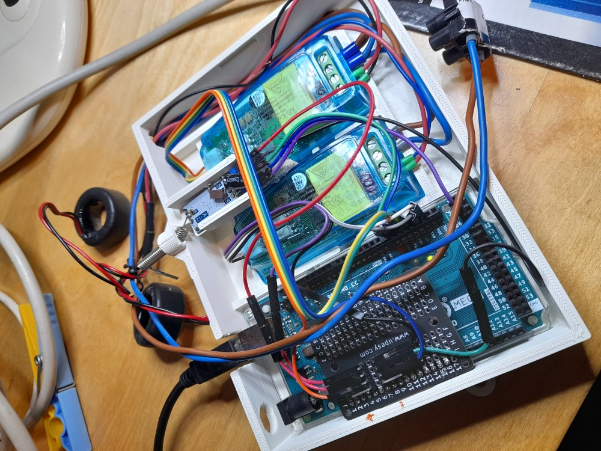

# Transmetteur de jardin

Transmetteur de puissance photovoltaïque par radio HC12. Un Arduino **Mega 2560** installé au jardin mesure la puissance de deux blocs de panneaux solaires et l'envoie vers la maison (~30 m, pas de wifi sur site) toutes les 3 secondes.

Projet frère de [Albi](https://github.com/francfly12/Albi) — mêmes composants et mêmes leçons apprises.

## Photos

## Mesures

| Voie | Bloc | Puissance approx. |
|------|------|-------------------|
| PZEM1 | Bloc fixe (6 panneaux) | ~1800 W |
| PZEM2 | Tracker mobile (2 × 450 W) | ~900 W |

## Matériel

- Arduino **Mega 2560** (ports série hardware)
- 2 × **PZEM-004T v3.0** (bibliothèque [PZEM004Tv30](https://github.com/mandulaj/PZEM-004T-v30) de Jakub Mandula)
- 1 × **HC12** (9600 bauds, même lot que ALBI)
- Alim 5 V la plus stable possible + capa 100 nF au plus près des broches VCC/GND du HC12 (leçon ALBI : un 7805 dédié au HC12 a réglé les chutes de tension)

## Câblage

| Périphérique | Broche Mega | Broche périphérique |
|---|---|---|
| PZEM1 (bloc fixe) | TX1 (D18) / RX1 (D19) | RX / TX |
| PZEM2 (tracker) | TX2 (D16) / RX2 (D17) | RX / TX |
| HC12 | TX3 (D14) / RX3 (D15) | RXD / TXD |
| LED embarquée | D13 | — |

## Protocole radio

Une trame toutes les **3 s** : `A<p1>B<p2>\n` (ex. `A1802.5B913.0\n`)

- Seule la puissance (W) est transmise.
- Le `\n` final est **obligatoire** — leçon ALBI : sans lui, le récepteur ne détecte jamais la fin de trame (ok=0 rej=0).
- Marqueurs `A` et `B` distincts pour un parseur `strchr` simple côté réception.
- Si un des deux PZEM ne répond pas (NaN, ou partie AC non alimentée) : **aucune trame envoyée**, le récepteur garde sa dernière valeur (expiration à prévoir côté réception).
- LED D13 : flash de 2 ms à chaque trame envoyée (vérifiable sans PC).

## Remarques de mise en œuvre

- La bibliothèque `PZEM004Tv30` envoie son debug par défaut sur `Serial1` : il **faut** `#define PZEM_DEFAULT_DEBUG_PORT Serial` **avant** l'include, sinon du debug part sur le port d'un PZEM.
- `#include <SoftwareSerial.h>` requis avant l'include PZEM.
- Timing par `millis()`, pas de `delay()` bloquant (hors flash LED de 2 ms).

## Réception

Côté maison : réutiliser le sniffeur HC12 sur UNO R4 Minima (déjà réalisé pour ALBI) pour tester la réception.
